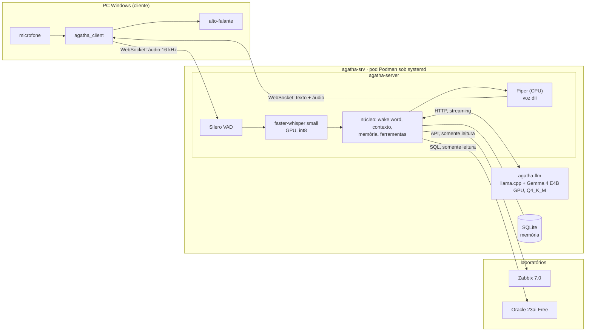

# Agatha

Assistente virtual por voz, estilo Jarvis/Alexa, rodando **100% local** num servidor caseiro com
uma GPU de 4 GB. Fala e entende português do Brasil, responde em streaming e consulta sistemas de
infraestrutura (Zabbix, Oracle) por ferramentas próprias, sem nenhuma API paga.

**Do fim da fala ao primeiro som da resposta: ~1,95 s** (mediana do último teste real no Windows,
13 falas, máximo de 2,17 s), com reconhecimento de voz, LLM e síntese de voz rodando no servidor.

```
você:   "Quanto é 10 dividido por 3?"
agatha: "Um instante. Dá 3,33."                                              (1º som em 1,8 s)
você:   "Tem alguma tablespace quase cheia?"  (modo conversa: sem chamar pelo nome de novo)
agatha: "Só um momento. A tablespace DADOS_APP está com 85.2% de uso."       (2,0 s)
```
(trecho real do teste de 12/10; a calculadora e o Oracle de laboratório foram consultados de verdade)

## O que ela faz

- **Conversa por voz** em PT-BR, com respostas curtas pensadas para serem ouvidas.
- **Wake word "Agatha"** e **modo conversa**: depois de cada resposta, por 20 s, não precisa chamar
  pelo nome de novo.
- **Memória explícita**: "lembra que meu banco de produção se chama PRDORA", "o que você lembra de
  mim?", "esquece isso". Os fatos ficam num SQLite e valem entre conversas.
- **Ferramentas** que o LLM decide chamar: calculadora; Zabbix (alertas ativos, CPU, memória,
  disco e tempo ligado de um host); Oracle (uso das tablespaces, sessões abertas). Todas somente
  leitura, com usuários de menor privilégio.
- **Fala natural de números, horas e siglas**: "62,5" vira "sessenta e dois vírgula cinco", "18h22"
  vira "dezoito e vinte e dois", "CPU" vira "cê pê u".

## Arquitetura



- **Cliente fino** (Windows): só captura o microfone e toca a resposta. Detecção de fala, wake word e
  tudo o mais ficam no servidor.
- **Servidor** (Oracle Linux 10 + GTX 1050 Ti): dois containers num pod Podman, gerenciados pelo
  systemd via Quadlet, com reinício automático e ordem de partida garantida por healthcheck.
- **Streaming de ponta a ponta**: o LLM gera em streaming, o texto é cortado em frases e cada frase
  vai para a síntese de voz assim que fica pronta. A Agatha começa a falar antes de terminar de pensar.
- **Half-duplex**: enquanto ela fala, o microfone é ignorado (ADR-006).

O diferencial do projeto é o **núcleo próprio** (orquestração, contexto, memória, ferramentas,
normalização da fala). Os componentes de base são open source consolidados:
[Silero VAD](https://github.com/snakers4/silero-vad),
[faster-whisper](https://github.com/SYSTRAN/faster-whisper),
[llama.cpp](https://github.com/ggml-org/llama.cpp) e [Piper](https://github.com/rhasspy/piper).

## Para onde vão os ~2 segundos

Medido em cada resposta e gravado no registro de turnos (`bench/turns_report.py`):

| etapa | tempo típico | o que acontece |
|---|---|---|
| fim da fala → VAD fecha a frase | ~0,5 s | silêncio necessário para saber que a pessoa terminou |
| transcrição (STT na GPU) | ~0,4 s | faster-whisper `small`, int8 |
| 1º token do LLM | ~0,5 s | o começo fixo do prompt fica no cache do llama.cpp |
| 1ª frase do LLM + TTS | ~0,4 s | ~17 tokens/s na GTX 1050 Ti; Piper ~50–100 ms por frase |
| rede e reprodução no cliente | ~0,13 s | |

Com ferramenta, a Agatha diz uma frase curta ("Só um momento.") enquanto consulta, e o primeiro
som continua em ~1,7–2,1 s. Perguntas longas (10–20 s de fala) ficam em 2,3–2,9 s, porque a
transcrição e o prompt crescem.

### Restrições que moldaram o projeto

- **4 GB de VRAM** para STT e LLM juntos: pico de 3,66 GB. Cada escolha de modelo foi medida
  antes (`bench/`).
- **GPU Pascal**: driver NVIDIA fixado no branch 580 e CUDA 12.x, porque o branch 590+ e o CUDA 13
  não suportam mais a arquitetura.
- **Contexto de 4096 tokens**: o prompt fixo (regras, exemplos das ferramentas, memória) ocupa
  ~1.670 tokens e não pode mudar entre turnos, para o cache do llama.cpp valer (ADR-007).

## Decisões de arquitetura

Cada decisão relevante tem um ADR em [`docs/adr/`](docs/adr/), com contexto, opções medidas e
consequências:

| ADR | decisão |
|---|---|
| [001](docs/adr/0001-arquitetura-inicial.md) | arquitetura cliente-servidor, 100% local, containers Podman |
| [002](docs/adr/0002-stt-faster-whisper-small-gpu.md) | STT com faster-whisper `small` na GPU |
| [003](docs/adr/0003-protocolo-websocket.md) / [006](docs/adr/0006-protocolo-v2-half-duplex.md) | protocolo WebSocket; v2 com respostas faladas e half-duplex ([especificação](docs/protocol.md)) |
| [004](docs/adr/0004-llm-gemma-4-e4b.md) | LLM Gemma 4 E4B (Q4_K_M) no llama.cpp |
| [005](docs/adr/0005-tts-piper-dii.md) | TTS com Piper e a voz "dii", na CPU |
| [007](docs/adr/0007-ajustes-latencia-conversa.md) | ajustes de latência: cache do prompt, frases curtas, endpointing |
| [008](docs/adr/0008-wake-word-pela-transcricao.md) | wake word pela transcrição, com modo conversa |
| [009](docs/adr/0009-ferramentas-tool-calling.md) | ferramentas via tool calling, com exemplos no prompt |
| [010](docs/adr/0010-memoria-explicita.md) | memória explícita em SQLite |
| [011](docs/adr/0011-zabbix-laboratorio.md) / [012](docs/adr/0012-oracle-laboratorio.md) | laboratórios Zabbix e Oracle, ferramentas somente leitura |
| [013](docs/adr/0013-systemd-quadlet.md) | serviço do systemd com Quadlet |

## Qualidade e operação

- **Testes**: 175 no servidor e 3 no cliente, com VAD, STT, LLM e TTS falsos onde precisam de
  GPU. Rodam no GitHub Actions (servidor no Ubuntu, cliente no Windows).
- **Teste de fumaça** com a Agatha no ar: perguntas com voz sintética pelo WebSocket, conferindo
  transcrição, ferramenta, áudio e latência (`server/scripts/smoke.py`).
- **Benchmarks** (`bench/`): STT (WER e latência por modelo), LLM, TTS e tool calling (92/105 casos
  certos, incluindo frases mal transcritas e referências como "esquece isso").
- **Registro de turnos** em JSONL: cada fala e cada resposta, com os tempos de cada etapa e o
  primeiro som medido no cliente.

## Como rodar

| | |
|---|---|
| servidor (agatha-srv) | [`deploy/README.md`](deploy/README.md): preparação do host, imagens, systemd, logs |
| desenvolvimento do servidor | [`server/README.md`](server/README.md) |
| cliente (Windows) | [`client/README.md`](client/README.md) |
| medições | [`bench/README.md`](bench/README.md) |

Resumo, no servidor já preparado:

```bash
deploy/install-systemd.sh            # instala as units do Quadlet e sobe o pod
.venv/bin/python server/scripts/smoke.py
```

E no Windows: `.venv\Scripts\python -m agatha_client`, depois "Agatha, que horas são?".

## Estrutura do repositório

```
agatha/
├── server/    # núcleo, VAD, STT, TTS, ferramentas (roda no agatha-srv)
├── client/    # microfone e reprodução (roda no Windows)
├── deploy/    # Containerfiles, units do Quadlet, laboratórios Zabbix e Oracle
├── bench/     # benchmarks e relatório de latência
└── docs/      # ADRs e especificação do protocolo
```

Modelos, memória e logs ficam fora do repositório, em `/dados/agatha/{models,data,logs}`.

## Hardware do servidor

| Item  | Especificação                                        |
|-------|------------------------------------------------------|
| SO    | Oracle Linux 10, kernel UEK 8                        |
| CPU   | Intel i5-7400 (4 núcleos, AVX2)                      |
| RAM   | 16 GB DDR4                                           |
| GPU   | NVIDIA GTX 1050 Ti, 4 GB VRAM (Pascal), driver 580   |
| Stack | Podman 5 + Quadlet, NVIDIA Container Toolkit (CDI), CUDA 12.x |

## Roadmap

- [x] **Fase 0**: servidor preparado e esqueleto do repositório
- [x] **Fase 1**: servidor ouve, transcreve e imprime (PT-BR)
- [x] **Fase 2**: conversa ponta a ponta com streaming e medição de latência
- [x] **Fase 3**: wake word, memória e primeiras ferramentas (Zabbix, Oracle, calculadora)
- [ ] **Fase 4**: serviço systemd, logs, testes e documentação (em validação: subida no boot)
- [ ] Próximos: wake word dedicada no cliente ([openWakeWord](https://github.com/dscripka/openWakeWord)),
      transcrição parcial para perguntas longas, interromper a Agatha enquanto ela fala (barge-in)
